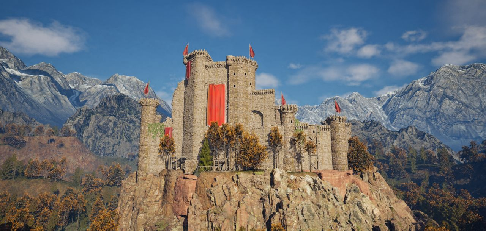
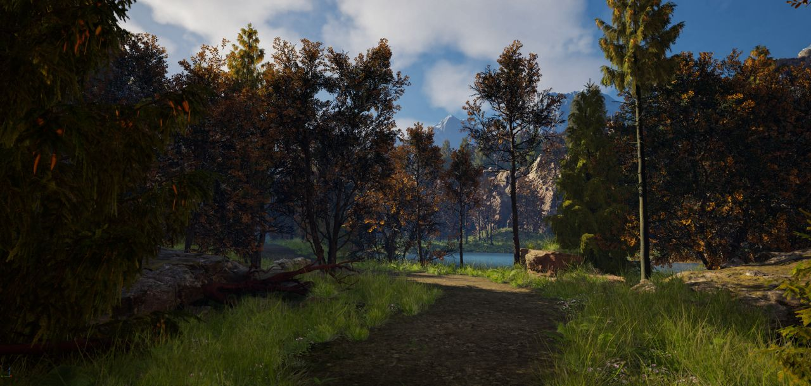
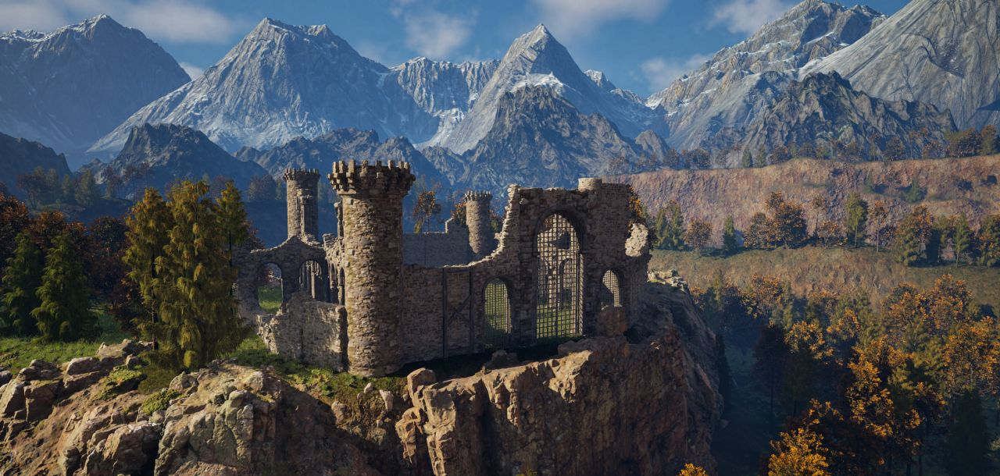
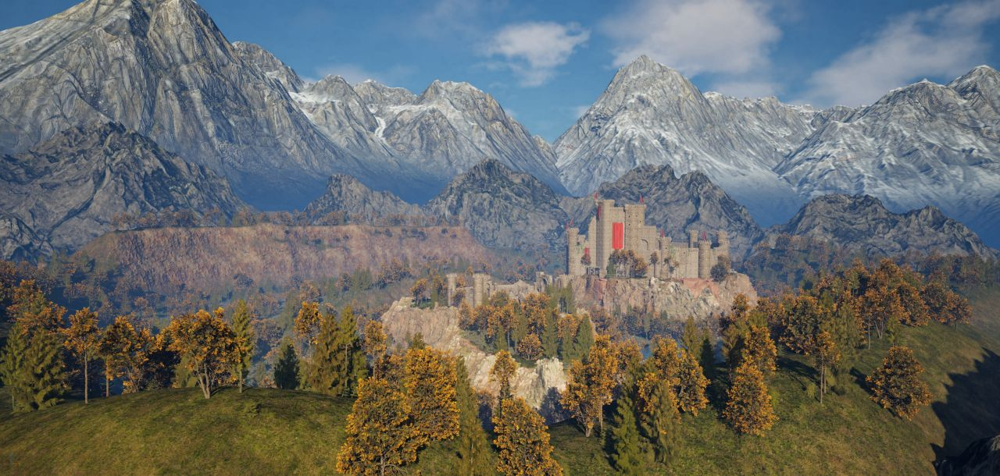

# Highreach Keep

A visual showcase of a large-scale, open-world medieval environment built in Unreal Engine 5. This project was developed as a solo practice in cinematic world-building, composition, and natural environmental lighting.

## Project Status: Visual Archive
Due to the massive file size of the Unreal Engine 5.6 project and local storage limitations, the original source files are no longer available. This repository serves as a permanent visual archive of the completed level design and environment art.

---

## Technical Details
* **Engine:** Unreal Engine 5.6
* **Role:** Solo Developer (Level Design, Natural Set Dressing, Cinematic Lighting)
* **Design Philosophy:** Constructing a sense of history through contrasting states—from the active, flag-bearing citadel perched high above to the crumbling, ivy-covered historical remnants in the valleys below.

---

## Design & Environment Focus

### 1. Architectural Storytelling & Natural Elevation
High-elevation fortification perched on sheer cliff faces, using natural bottlenecks and defensive geography. Contrast between the maintained, active stronghold and the crumbling, forgotten ruins scattered across the lower crags.
* Featuring heavy stone work, defensive towers, and heraldic red banners.
* Ruins showing natural decay, crumbling archways, and vegetation overrun.

### 2. Alpine Composition & Natural Flora
Set dressing uses a transitional seasonal palette (autumnal foliage, golden-leafed deciduous trees, and dark evergreens) to ground the medieval structures in a rugged, lifelike mountain ecosystem.
* Giant, snow-capped mountain ranges framing the world boundaries to create scale and depth.
* A winding river gorge cutting through steep rock faces, bridging the gap between historical points of interest.
* A low-altitude forest featuring dense undergrowth, natural dirt pathways, and a secluded mountain lake.

### 3. Atmosphere & Natural Illumination
Daytime lighting with high-contrast shadows to bring out the natural rock textures and weathered stone.
* Uses volumetric clouds and atmospheric fog to separate foreground details from the distant peaks.
* Cinematic camera perspectives designed to showcase depth of field and the expansive 3D space.

---

## Gallery

### The High Stronghold
A fortified keep built directly into the highest cliffs, overlooking the river valley below.

### Natural Progression Paths
Winding dirt trails and densely forested valleys leading toward the natural water systems.

### Structural Contrast
The ancient ruined fortress on the opposite ridge, illustrating decay and overgrowth.

### Cinematic Vistas
The scale of the world, highlighting the transition from deep forest to towering peaks.

